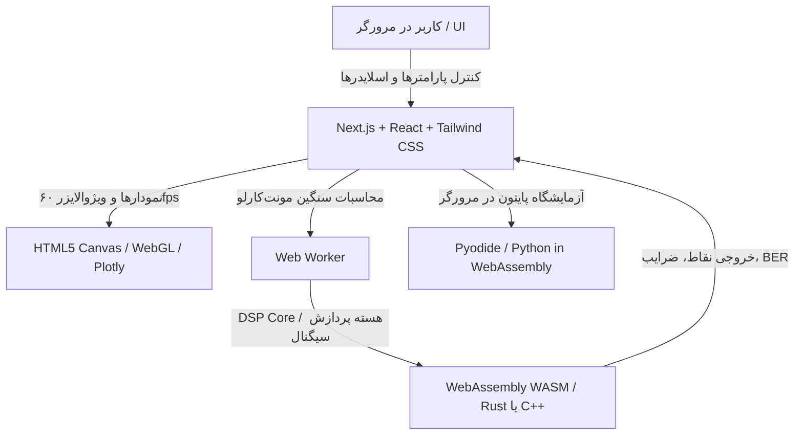

<div dir="rtl" style="text-align: right;">

# پروپوزال جامع توسعه پلتفرم «DigiComm Studio»
## آزمایشگاه تعاملی و تحت وب مخابرات دیجیتال بر پایه مرجع Proakis & Salehi

---

### ۱. چکیده اجرایی (Executive Summary)

مهندسی مخابرات سیستم و مخابرات دیجیتال از پایه‌ای‌ترین و در عین حال انتزاعی‌ترین حوزه‌های مهندسی برق است. کتاب مرجع **Digital Communications (ویرایش پنجم)** تألیف جان پروکیس (John G. Proakis) و مسعود صالحی (Masoud Salehi)، استاندارد طلایی دانشگاه‌های برتر جهان است، اما پیچیدگی ریاضیاتی بالا (هندسه فضای سیگنال، تئوری تخمین، تجزیه و تحلیل فرایندهای تصادفی و تداخل بین‌نمادی) همواره شکاف عمیقی میان «فرمول‌های روی کاغذ» و «درک شهودی رفتار سیگنال» برای دانشجویان ایجاد می‌کند.

پروژه **DigiComm Studio** یک مینی‌اپلیکیشن متن‌باز (Open Source)، فوق‌سریع و تعاملی تحت وب است که به دانشجو اجازه می‌دهد تمامی مفاهیم کتاب پروکیس را به صورت زنده، در کسری از ثانیه و بدون نیاز به نصب نرم‌افزارهای سنگین (مانند متلب با حجم بالای ۲۰ گیگابایت یا وابستگی به لایسنس) در مرورگر خود آزمایش، شبیه‌سازی و شهود‌ی‌سازی کند.

این پروژه برای انتشار در **GitHub** طراحی شده و قابلیت استفاده به عنوان پروژه دانشجویی، پلتفرم آزمایشگاهی دانشگاهی، یا ابزار خودآموز برای مهندسان سیستم و طراحان SDR (رادیو نرم‌افزاری) را دارد.

---

### ۲. بیان مسئله و چالش‌های وضع موجود (Problem Statement)

1. **سنگینی و انحصار متلب (MATLAB / Simulink):** دانشجویان معمولاً مجبور به نصب متلب یا حل تمرین‌های شبیه‌سازی طولانی هستند که نیازمند لایسنس گران‌قیمت یا نسخه‌های کرک‌شده ناپایدار است.
2. **عدم بازخورد بلادرنگ (Lack of Real-Time Feedback):** در کدهای مرسوم اسکریپتی، برای دیدن اثر تغییر SNR یا فیلتر رول‌آف، دانشجو باید کد را مجدداً اجرا کند؛ این وقفه مانع درک شهودی و پیوسته فیزیک سیگنال می‌شود.
3. **انتزاعی بودن مفاهیم پروکیس:** عناوینی مانند:
   - دوران و اعوجاج صورت فلکی (Constellation Rotation & Phase Noise)
   - نحوه باز شدن و بسته شدن نمودار چشم (Eye Diagram) تحت فیلتر Raised Cosine
   - نمودار مشبک ترلیس (Trellis) و مسیر بقا در الگوریتم ویتربی (Viterbi)
   - اکولایزرهای وفقی (LMS / MMSE) و نحوه همگرایی ضرایب فیلتر
   همگی نیازمند مصورسازی زنده و متحرک (Animated & Dynamic) هستند.

---

### ۳. اهداف و چشم‌انداز پلتفرم (Vision & Key Objectives)

- **Zero-Setup (دسترسی بدون نیاز به نصب):** اجرا بر روی هر مرورگر مدرن (موبایل، تبلت، لپ‌تاپ) تنها با باز کردن یک لینک GitHub Pages یا Vercel.
- **Interactive First (تعامل زنده با اسلایدرها):** با تکان دادن اسلایدر SNR، نویز گاوسی بلافاصله ابر نقاط صورت فلکی را باز و بسته کند.
- **شبیه‌سازی برخط با دقت بالا:** اجرای میلیون‌ها بیت شبیه‌سازی مونت‌کارلو در ثانیه در پشت‌صحنه مرورگر.
- **دوگانه تئوری-عملی (Theory vs. Simulation):** مقایسه همزمان منحنی‌های تحلیلی ریاضی کتاب پروکیس (مثل $Q(\sqrt{2E_b/N_0})$) با داده‌های تجربی شبیه‌سازی شده.
- **تولید خودکار کد پایتون:** هر تنظیمی که دانشجو در وب انجام می‌دهد، یک کلیک با کپی کردن کد معادل پایتون (NumPy/SciPy) برای پروژه‌ها و گزارش کار آزمایشگاه فاصله داشته باشد.

---

### ۴. معماری فنی و پشته پیشنهادی (Technology Stack)

برای دستیابی به حداکثر سرعت، بدون تحمیل هزینه سرور و بهینه‌ترین حالت برای میزبانی در GitHub:



#### چرا این پشته؟
1. **هسته محاسباتی با اولویت مشارکت دانشجویان (TypeScript-First DSP Engine):**
   - **اولویت اول — TypeScript تمیز و ماژولار در Web Workers:** اکثر دانشجویان و محققان مخابرات (ECE) برنامه‌نویس سیستم (Rust/C++) نیستند. استفاده از TypeScript خوانا باعث می‌شود هر دانشجوی سال سوم یا چهارم کارشناسی بتواند یک مدولاسیون جدید یا یک الگوریتم اکولایزر را بدون سردرگمی در زنجیره ابزار Rust اضافه و پول‌ریکوئست (PR) ارسال کند.
   - **رعایت اصول V8 JIT:** عدم استفاده از `number[]`، تخصیص از پیش تمام حافظه‌ها با `Float64Array` و توابع تک‌ریختی (Monomorphic) بدون Allocation در حلقه داغ نمادها.
   - **موتور تولید نویز سبک و آکادمیک:** استفاده از **xoshiro128+** ترکیب‌شده با تبدیل **Box-Muller** (سریع با حدود ۵ نانوثانیه در هر نمونه و تطابق ۱۰۰٪ با فرمول‌های کتاب پروکیس بدون نیاز به جداول پیچیده Ziggurat).

2. **خط لوله داده ۶۰ فریم بدون سربار حافظه (Triple-Buffered Transferable Ownership):**
   - به جای استفاده از `SharedArrayBuffer` (که نیازمند هدرهای COOP/COEP است و در GitHub Pages اجرا نمی‌شود)، از الگوی بافر سه‌گانه انتقالی استفاده می‌شود:
     * ورکر شبیه‌سازی نرخ بیت‌ها و خطاها را با حداکثر سرعت می‌شمارد.
     * برای UI، تنها یک اسنپ‌شات کوچک (مثلاً ۲٬۰۰۰ تا ۵٬۰۰۰ نقطه I/Q آخر) با استفاده از `self.postMessage(buf.buffer, [buf.buffer])` به صورت Zero-Copy به رشته اصلی ارسال می‌شود.
     * رشته اصلی پس از ترسیم، همان بافر را به ورکر بازمی‌گرداند؛ این یعنی **فشار Garbage Collection به صفر می‌رسد**.

3. **معماری رندرینگ لایه‌ای (Layered Renderer Interface):**
   - تعریف اینترفیس انتزاعی `DiagramRenderer`:
     ```typescript
     interface DiagramRenderer {
       drawConstellation(points: Float32Array): void;
       drawEyeDiagram(traces: Float32Array[]): void;
       resize(w: number, h: number): void;
       dispose(): void;
     }
     ```
   - **فاز MVP:** پیاده‌سازی با Canvas 2D بهینه‌شده (رسم تمام نقاط صورت فلکی در یک مسیر تک‌مرحله‌ای با `ctx.fill()`).
   - **فاز V1:** سوییچ روان به یک شیدر سبک WebGL بدون دستکاری کد کامپوننت‌ها، جهت ایجاد افکت فسفری و بازماندگی نوری (Phosphor Persistence) در اسیلوسکوپ نمودار چشم.

4. **اعتبار آماری تخمین BER و توقف هوشمند (Statistical Validity & Adaptive Stopping):**
   - برای این‌که شبیه‌سازی در نقاط با خطای نادر ($P_e \approx 10^{-6}$) از نظر علمی دقیق باشد، تعداد خطاهای مشاهده شده ($k$) تعیین‌کننده پهنای بازه اطمینان است ($k \ge (z_\alpha / \delta)^2$):
     * برای بازه ۹۵٪ با خطای نسبی $\pm 20\%$: نیاز به حداقل ۱۰۰ خطا ($\approx 10^8$ بیت).
     * برای بازه ۹۰٪ با خطای نسبی $\pm 50\%$: نیاز به حداقل ۱۱ خطا ($\approx 1.1 \times 10^7$ بیت).
   - **قانون توقف هوشمند (Adaptive Stopping Rule):** ورکر تا زمانی که به ۵۰ خطا برسد یا سقف زمانی ۳ ثانیه پر شود شبیه‌سازی می‌کند. اگر برای SNRهای بسیار بالا نیاز به بیش از $10^9$ بیت باشد، سیستم منحنی تئوری $Q$-Function را با خط‌چین نمایش می‌دهد و نوار بازه اطمینان (Confidence Bar) را برای درک مفهوم قانون اعداد بزرگ به دانشجو نشان می‌دهد.

5. **رویکرد آموزشی پایتون (Python Code Exporter به جای Pyodide):**
   - دکمه صادرات کد بلادرنگ که پارامترهای اسلایدر را به اسکریپت تمیز پایتون (NumPy و SciPy) تبدیل می‌کند؛ بدون تحمیل حجم ۱۵ تا ۲۰ مگابایتی Pyodide به کاربر.

---

### ۵. سرفصل‌ها و ماژول‌های شبیه‌ساز (منطبق بر فصول کتاب پروکیس)

| ماژول در اپلیکیشن | فصل متناظر در کتاب Proakis | قابلیت‌های تعاملی و آموزشی |
| :--- | :--- | :--- |
| **۱. استودیوی صورت فلکی و فضای سیگنال (Constellation Studio)** | فصول ۲ و ۳ (Signal Space & Modulations) | • مصورسازی پایه‌های متعامد گرام-اشمیت (Gram-Schmidt)<br>• شبیه‌سازی انواع مدولاسیون: M-PAM، M-PSK، M-QAM (مربعی، متقاطع، دایره‌ای)، FSK<br>• نگاشت گری (Gray Coding) در برابر نگاشت طبیعی و مشاهده فاصله همینگ<br>• اثر نویز فاز (Phase Noise / Jitter) و انحراف فرکانسی (Frequency Offset) |
| **۲. کانال نویز و گیرنده بهینه (AWGN & Optimal Receivers)** | فصل ۴ (Optimum Receivers for AWGN) | • تنظیم زنده نسبت $E_b/N_0$ و انحراف معیار نویز $\sigma = \sqrt{N_0/2}$<br>• مناطق تصمیم‌گیری حداکثر درست‌نمایی (ML Decision Regions / Voronoi)<br>• شبیه‌سازی فیلتر منطبق (Matched Filter) در حوزه زمان و رسم خروجی در لحظه نمونه‌برداری $t=T$<br>• نمودار زنده احتمال خطای سمبل (SER) و خطای بیت (BER) در برابر مرزهای تئوری پروکیس (Union Bound و فرمول‌های دقیق) |
| **۳. مدولاسیون با فاز پیوسته (CPM & CPFSK)** | فصل ۳ و ۴ (Signaling with Memory) | • نمایش درختواره فاز (Phase Tree) و استوانه فاز<br>• مقایسه چگالی طیف توان (PSD) مدولاسیون‌های MSK و GMSK با QPSK<br>• فهم علت راندمان طیفی بالا در استانداردهای موبایل (GSM / IoT) |
| **۴. همگام‌سازی فاز و زمان‌بندی (Sync Lab)** | فصل ۵ (Carrier & Symbol Synchronization) | • شبیه‌سازی حلقه قفل فاز (PLL) و حلقه کوستاس (Costas Loop)<br>• نمایش زنده در چرخش بودن نقاط کانستلیشن و سپس «قفل شدن» حلقه بر روی فاز صحیح<br>• بازیابی زمان‌بندی سمبل به روش گاردنر (Gardner) و Early-Late Gate |
| **۵. کانال‌های باند محدود، ISI و نمودار چشم** | فصل ۹ (Band-Limited Channels & ISI) | • فیلترهای نایکوئیست و فیلتر کسینوس وارونه (Raised Cosine / Root-Raised Cosine)<br>• اسلایدر ضریب رول‌آف ($\alpha \in [0, 1]$) و مصورسازی پهنای باند مازاد<br>• **نمودار چشم مجازی (Interactive Eye Diagram):** اسیلوسکوپ اختصاصی با قابلیت سنجش حاشیه نویز (Noise Margin)، اعوجاج صفر و جیتر زمانی |
| **۶. اکولایزرهای وفقی (Adaptive Equalization)** | فصل ۱۰ (Adaptive Equalization) | • مدل‌سازی کانال‌های چندمسیره (Multipath) با اعوجاج دامنه و فاز<br>• شبیه‌سازی اکولایزرهای ZF (Zero-Forcing) و MMSE<br>• الگوریتم LMS و RLS: مشاهده پویا و انیمیشنی تنظیم ضرایب تپ‌ها (Filter Taps) و باز شدن مجدد چشم بسته شده |
| **۷. تئوری اطلاعات و کدینگ کانال (Coding Lab)** | فصول ۶، ۷ و ۸ (Codes & Information Theory) | • شبیه‌سازی حد شانون: $C = B \log_2(1 + \mathrm{SNR})$<br>• کدهای بلوکی خطی: همینگ، رید-سالامون، کدگذاری و ماتریس سندروم<br>• کدهای کانولوشنال و ترلیس ویتربی: نمایش گراف ترلیس متحرک با انتخاب مسیر برنده (ACS: Add-Compare-Select) |
| **۸. سیستم‌های پیشرفته: OFDM و مایمو (OFDM & MIMO)** | فصول ۱۱، ۱۳ و ۱۵ (Multicarrier & MIMO) | • ارتوگونالیتی زیرحامل‌ها در حوزه زمان و فرکانس<br>• شبیه‌سازی اضافه شدن پیشوند چرخه‌ای (Cyclic Prefix) برای حذف ISI<br>• کدهای فضا-زمان آلاموتی (Alamouti 2x2 STBC) و تفاوت دایورسیتی در برابر مالتی‌پلکسینگ فضایی |

---

### ۶. تجربه کاربری و سناریوی تعاملی (UX / Interactive Workflow)

رابط کاربری این مینی‌اپ شبیه به یک **میز کار مهندسی تعاملی (Virtual DSP Workbench)** طراحی می‌شود:

1. **نوار ابزار بالا (Top Toolbar):** انتخاب فصل و سناریو (مثلاً: *فصل ۴: گیرنده بهینه 16-QAM در AWGN* یا *فصل ۹: آنالیز نمودار چشم نایکوئیست*).
2. **پنل کنترل چپ (Control Panel):**
   - اسلایدر $E_b/N_0$ (از -5dB تا +25dB)
   - انتخاب مپینگ بیت‌ها (Gray Code / Binary)
   - فیلتر پالس (Rectangular, Sinc, RRC با اسلایدر $\alpha$)
   - تعداد نمونه‌های شبیه‌سازی (از $10^3$ تا $10^7$ سمبل)
3. **محیط بصری میانی (Main Canvas):**
   - نمایش دوگانه (Dual View): صورت فلکی در کنار شکل موج زمانی یا نمودار چشم.
   - امکان کشیدن و رها کردن نقاط تصمیم‌گیری با ماوس برای مشاهده میزان افزایش خطای سمبل!
4. **پنل تحلیل پایین و راست (Analytics & Theory):**
   - شمارنده بیت‌های خطادار ($P_e$) و نرخ بلادرنگ BER.
   - نمودار لاگاریتمی مقایسه تئوری با داده‌های تجربی که با ورود هر بسته داده، نقطه جدیدی روی منحنی می‌نشاند.
5. **دکمه جادویی «Export Code»:**
   - کپی فوری کد پایتون/متلب معادل این شبیه‌سازی برای قرار دادن در تکلیف کلاسی یا مقاله دانشجو.

---

### ۷. ساختار پیشنهادی مخزن گیت‌هاب (Repository Structure)

برای اینکه پروژه برای جامعه متن‌باز جذاب باشد و استانداردهای توسعه روز را رعایت کند:

```text
digicomm-studio/
├── .github/
│   └── workflows/
│       └── deploy.yml          # استقرار خودکار روی GitHub Pages
├── apps/
│   └── web/                    # رابط کاربری تحت وب (Next.js 14)
│       ├── src/
│       │   ├── app/            # صفحات فصول و آزمایشگاه‌ها
│       │   ├── components/     # اسیلوسکوپ، بوم صورت فلکی، اسلایدرها
│       │   ├── hooks/          # هوک‌های ارتباط با ورکر شبیه‌سازی
│       │   └── workers/        # وب‌ورکرهای پردازش سیگنال
├── packages/
│   ├── dsp-core/               # کتابخانه هسته ریاضیات و مخابرات (TypeScript / Rust-WASM)
│   │   ├── src/
│   │   │   ├── modulation/     # PAM, PSK, QAM, FSK
│   │   │   ├── channels/       # AWGN, Rayleigh, Rician, Filtered
│   │   │   ├── equalizers/     # ZF, MMSE, LMS
│   │   │   └── coding/         # Hamming, Viterbi
│   │   └── tests/              # تست‌های صحت ریاضی بر اساس فرمول‌های پروکیس
│   └── python-snippets/        # کدهای نمونه پایتون معادل هر ماژول
├── docs/                       # مستندات آموزشی، راهنمای تدریس برای اساتید
├── README.md                   # معرفی جذاب پروژه با گیف‌ها و لایو دمو
└── LICENSE                     # پروانه متن‌باز MIT
```

---

### ۸. نقشه راه پیاده‌سازی گام‌به‌گام (Development Roadmap)

#### فاز اول: حداقل محصول پذیرفتنی و ویروسی (MVP - ماه اول)
- **Constellation Studio:** با اسلایدر نویز و SNR پویا برای BPSK, QPSK, 16-QAM, 64-QAM با نمایش نقاط و برچسب‌های کدگذاری گری.
- **Pulse Shaping & Spectrum Lab:** پل ارتباطی میان درس سیگنال‌ها (فوریه) و مخابرات؛ سوییچ تعاملی میان پالس‌های Rectangular, Sinc, Raised Cosine و Root-Raised Cosine در حوزه زمان به همراه نمایش همزمان طیف فرکانسی توان (PSD).
- **منحنی زنده BER با توقف تطبیقی (Adaptive Stopping):** اجرای موازی در Web Worker با قانون ۵۰ خطا / ۳ ثانیه، نوار باریکه اطمینان (Confidence Interval) و نمایش خط‌چین تئوری $Q$-function.
- **موتور رندرینگ Canvas 2D:** بر پایه اینترفیس انتزاعی `DiagramRenderer` با نرخ ثابت ۶۰ فریم بر ثانیه.
- **صادرات کد پایتون:** امکان کپی فوری اسکریپت شبیه‌سازی معادل NumPy.

#### فاز دوم: کانال‌های باند محدود، نمودار چشم و همگام‌سازی (ماه دوم)
- اسیلوسکوپ تعاملی **Eye Diagram** با خطوط روی هم افتاده و ارتقا به WebGL Shader برای شبیه‌سازی درخشش و ته‌نشینی فسفری (Phosphor Persistence).
- ماژول بازیابی فاز و زمان: حلقه Costas و الگوریتم Gardner (فصل ۵ پروکیس) با نمایش بصری چرخش صورت فلکی تا لحظه قفل شدن.

#### فاز سوم: اکولایزرهای وفقی و کدینگ کانال (ماه سوم)
- اکولایزرهای LMS و MMSE و مشاهده زنده باز شدن چشم در حضور تداخل بین‌نمادی شدید (ISI).
- نمایش متحرک دیاگرام ترلیس (Trellis) و الگوریتم ویتربی برای کدهای کانولوشنال (فصل ۸ پروکیس).

#### فاز چهارم: سیستم‌های پیشرفته و جامعه‌سازی (ماه چهارم به بعد)
- شبیه‌ساز ماژولار OFDM و چندحاملی (فصل ۱۱).
- دو زبانه کردن پلتفرم (انگلیسی و فارسی) برای استفاده دانشگاهی در داخل و خارج کشور.
- انتشار رسمی روی گیت‌هاب و معرفی در ردیت (r/ECE, r/DSP) و لینکدین برای دریافت فیدبک اساتید و مهندسان مخابرات.

---

### ۹. جمع‌بندی و ارزش پیشنهادی

این مینی‌اپ تبدیل به یکی از محبوب‌ترین پروژه‌های آموزشی گیت‌هاب در حوزه DSP و مخابرات خواهد شد؛ زیرا دست روی نقطه‌ای می‌گذارد که بیش از ۴۰ سال است برای دانشجویان دشوار بوده است: **تبدیل ریاضیات سنگین کتاب پروکیس به یک تجربه تعاملی و لذت‌بخش بصری**.

</div>
